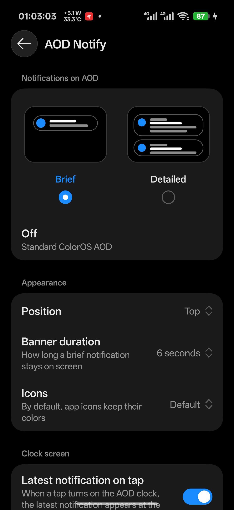

# AOD Notify

Brief and detailed notifications on the Always-On Display of ColorOS 17, in the style of One UI.
An LSPosed module (modern libxposed API 101/102).

[Русский](README.ru.md)



## Features

- **Brief**: a ColorOS-style banner with a One UI animation shows each new notification for a few seconds.
- **Detailed**: notification cards stay on the AOD, up to four at a time.
- Position (top, center, bottom), banner duration, colored or monochrome icons with a choice of color.
- **Latest notification on tap**: when power saving has hidden the AOD clock and you tap the screen, the latest notification shows with the clock and goes away with it.
- Pocket check: nothing is shown while the phone is in a pocket.
- Respects the system setting that hides lock screen content, and private apps.
- The settings screen is built from the real ColorOS components of the system Settings app (blurred header, glass back button). If they cannot be loaded, a look-alike screen opens instead.
- A **Notifications** row is added to the system settings: Home screen, lock screen & style → Always-On Display → Display settings → Notifications.
- The interface follows the system language: 67 languages, every language ColorOS offers.
- Settings apply immediately, no restart needed.

## Requirements

- ColorOS 17. Developed and tested on a OnePlus 15T (China ROM) with AOD app 17.001.0021. Other ColorOS 17 builds should work. On other versions, the row in system settings may not appear, and the module then leaves that page as it is.
- Root and LSPosed 2.x with libxposed API 101 or newer.

## Installation

1. Install the APK.
2. LSPosed → Modules → AOD Notify: enable it. Scope: **System UI** and **Always-On Display** (`com.oplus.aod`). The second one is only needed for the row in system settings, and the module requests it on first launch: confirm it in the LSPosed notification.
3. Restart System UI (or reboot) after installing or updating. For the settings row, also close Always-On Display from recents after the scope was added.
4. Open AOD Notify and pick a mode.

To undo everything, disable the module in LSPosed and restart System UI. The module does not change system settings or files.

Logs: LSPosed → Logs (lines with `AodNotify`).

## Building

No Gradle: `build.sh` runs aapt2, javac, d8, zipalign and apksigner directly. It needs a JDK 17+, Python 3 and Git Bash on Windows.

Put these files from the Android SDK into `tools/` (or point `TOOLS` at a folder that has them):

| File | From the Android SDK |
| --- | --- |
| `aapt2.exe`, `zipalign.exe`, `libwinpthread-1.dll` | `build-tools/36.x/` |
| `d8.jar`, `apksigner.jar` | `build-tools/36.x/lib/` |
| `android.jar` | `platforms/android-36/` |

```bash
VERSION_CODE=1 VERSION_NAME=1.0.0 bash build.sh
```

The APK lands in `out/`. On the first build a signing key is created in `keystore/`. Keep that key: an update installs over the old version only if it is signed with the same key. Set `JDK_BIN` if your JDK is not in `C:/Program Files/Java/jdk-25/bin`.

`libs/` holds the [libxposed](https://github.com/libxposed) API, interface and service jars (Apache License 2.0).

### Translations

Strings live in `res/values-*/strings.xml`, with English in `res/values`. The row in AOD's settings is inflated by AOD's own code, which cannot read the module's string references, so `build.sh` writes `res/xml-*/aod_entry.xml` for each language from its `aod_entry_title`. In right-to-left languages, a string that starts with a Latin name (AOD, ColorOS) begins with an invisible U+200F mark so that it stays right-aligned.

## License

[GPL-3.0](LICENSE)
